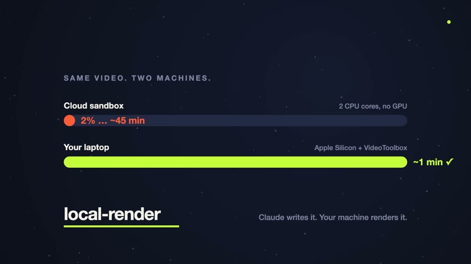
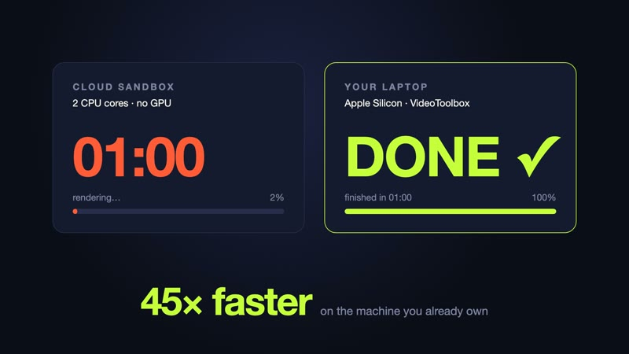
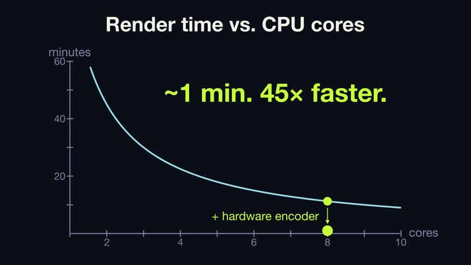
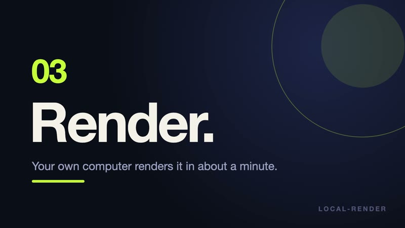

<p align="center"></p>

# local-render

**Claude writes the animation. Your computer renders it.**

Agent Skills that let Claude hand heavy video rendering off to your own machine instead of
rendering inside its cloud sandbox.

## The problem

In claude.ai, Claude's sandbox has about 2 CPU cores and no GPU. Claude is great at
*writing* animation code and bad at *rendering* it there:

| | Cloud sandbox | A MacBook Air (Apple Silicon) |
|---|---|---|
| CPU | ~2 cores | 8+ cores |
| GPU | none | Metal GPU |
| Video encoder | software only | VideoToolbox hardware encoder |
| A 30-second 1080p motion graphic | 30–60 minutes, often hitting timeouts | about a minute |

So local-render splits the job: **Claude writes a "render pack", your machine renders it.**

## Two ways to use it

```
1. Chat → zip → local                    2. Claude Code direct
   ───────────────────                      ─────────────────────
   claude.ai + render-pack skill            Claude Code + render-run skill
     writes the project                       you describe the video
     builds my-video-render-pack.zip          it writes a pack into a folder
   you download the zip                       previews a frame, you approve
   Claude Code + render-run skill             renders on your machine
     unzips safely, checks tools,
     shows what will run, asks, renders
   (or unzip and run `sh run.sh` yourself)
```

A **render pack** is a folder (or zip) with everything needed to render one video:

```
render.json     manifest: engine, size, fps, length, required tools, exact command
src/            source code
assets/         images, fonts, audio
runtime/        the local-render renderer (plain Python, standard library only)
run.sh          one-command render on macOS/Linux
run.ps1         one-command render on Windows
README.md       plain-language "how to render this"
preview.png     optional test frame
```

## Install

### claude.ai (render-pack skill)

1. Build the skill zips (or download them from this repo's Releases page if available):
   ```bash
   git clone https://github.com/dguraya01/local-render && cd local-render
   sh scripts/package_skills.sh
   ```
   This writes `dist/render-pack.zip` and `dist/render-run.zip`.
2. In claude.ai open **Settings → Capabilities → Skills**, choose **Upload skill**, and upload
   `dist/render-pack.zip`. (Code execution must be on.)

### Claude Code (both skills)

As a plugin, in one go:

```bash
claude plugin marketplace add dguraya01/local-render
```

```bash
claude plugin install local-render@local-render
```

Or inside Claude Code: `/plugin marketplace add dguraya01/local-render`, then
`/plugin install local-render@local-render`.

Or as personal skills, copied into `~/.claude/skills/`:

```bash
sh scripts/install_claude_code.sh
```

## 60-second quickstart

1. In claude.ai (with render-pack installed), ask:
   > Make me an 8-second motion graphic announcing our app launch. Dark background, lime accent.
2. Claude writes the project and gives you `app-launch-render-pack.zip`. Download it.
3. Open Claude Code in your Downloads folder and say:
   > Render app-launch-render-pack.zip
4. Claude unzips it safely, shows you what will run and which tools it found, and asks.
   Say yes. About a minute later you have `app-launch.mp4`.

No Claude Code? Unzip the pack, open a terminal in the folder, and run `sh run.sh`
(Windows: `powershell -ExecutionPolicy Bypass -File run.ps1`). The script tells you if a
tool is missing and how to install it.

## Engines

| Engine | Good for | Needs |
|---|---|---|
| `html-canvas` | Kinetic type, UI motion, canvas/WebGL, CSS animation | Node 18+, Chrome/Edge/Chromium, ffmpeg |
| `remotion` | React motion graphics, data-driven video | Node 18+ |
| `blender` | 3D scenes, product shots, abstract loops | Blender 4.2+, ffmpeg |
| `manim` | Math and explainer animations | Manim Community 0.18+, ffmpeg |
| `ffmpeg` | Slideshows, image sequences, stills + music | ffmpeg |

Every pack picks the fastest encoder that actually works on the machine: **VideoToolbox**
(`h264_videotoolbox` / `hevc_videotoolbox`) on Macs, **NVENC** on NVIDIA GPUs, otherwise
**libx264** `-preset fast -crf 18`. Adapters are small Python files; see
[engines/README.md](engines/README.md) to add one.

## Examples

Every example is a complete pack. `cd examples/<engine> && sh run.sh` renders it.
Times below are wall-clock renders on a MacBook Air (Apple M3, 8 cores, 16 GB), including
browser/Blender startup, with the encoder each pack picked automatically.

| | Example | Engine | Video | Render time | Encoder |
|---|---|---|---|---|---|
|  | [Write in the cloud. Render at home.](examples/html-canvas) | html-canvas | 6 s, 1080p30 | **17.5 s** | h264_videotoolbox |
|  | [Same video, two machines](examples/remotion) | remotion | 5 s, 1080p30 | **4.2 s** | Remotion + VideoToolbox |
|  | [Orbit](examples/blender) | blender (Eevee) | 4 s, 1080p24 | **2 min 36 s** | h264_videotoolbox |
|  | [Why render locally?](examples/manim) | manim | 8 s, 1080p30 | **8.2 s** | h264_videotoolbox |
|  | [Write. Pack. Render.](examples/ffmpeg) | ffmpeg | 8.6 s, 1080p30 + audio | **2.3 s** | h264_videotoolbox |

The first html-canvas and Remotion runs also install npm packages (and Remotion downloads its
headless browser) once; the times above are with those already installed.

Render them all and print this table yourself: `python3 scripts/render_examples.py`.

## Safety

A render pack contains code, so render-run treats it as untrusted until you approve:

- **Safe unzip:** `safe_unzip.py` extracts into a new folder only, and refuses absolute paths,
  drive letters, `..` entries (zip-slip), symlinks, duplicate names and zip bombs. Nothing is
  written unless every entry passes.
- **Inspect first:** `inspect_pack.py` reads the pack as data. It validates `render.json`,
  checks tools, compares `runtime/`, `run.sh` and `run.ps1` byte-for-byte with trusted
  copies, lists every file that will execute, and flags risky lines (`subprocess`, network
  calls, file deletion, `eval`...).
- **You approve:** Claude shows you the command, `run.sh`, the risk level and any flags, and
  waits for a yes. It never installs a tool without asking.
- **Risk by engine:** `ffmpeg` packs are data only. `html-canvas` code runs in Chrome's
  sandbox. `remotion`, `blender` and `manim` packs run code with your user's permissions, so
  review them like any script from the internet.

## Repository layout

```
skills/render-pack/     SKILL.md, references/, scripts/build_pack.py   (claude.ai + Claude Code)
skills/render-run/      SKILL.md, references/, scripts/safe_unzip.py, inspect_pack.py
engines/                one adapter per engine + AUTHORING.md guides
engines/_runtime/       renderer copied into every pack (lr_render.py, lr_common.py, lr_validate.py)
engines/_build/         pack builder used by build_pack.py
schema/                 render.schema.json (JSON Schema 2020-12)
examples/               one working pack per engine
scripts/                package_skills.sh, install_claude_code.sh, build_examples.py, render_examples.py
tests/                  schema, pack round-trip, runtime integrity and zip-slip tests
.claude-plugin/         plugin.json + marketplace.json
```

## Development

```bash
python3 -m unittest discover -s tests          # no dependencies needed
python3 scripts/build_examples.py              # after editing engines/: refresh example runtimes
python3 scripts/render_examples.py             # render every example and time it
sh scripts/package_skills.sh                   # build dist/*.zip for claude.ai
```

Tests use only the standard library; if `jsonschema` is installed they also validate with it.

## License

MIT
